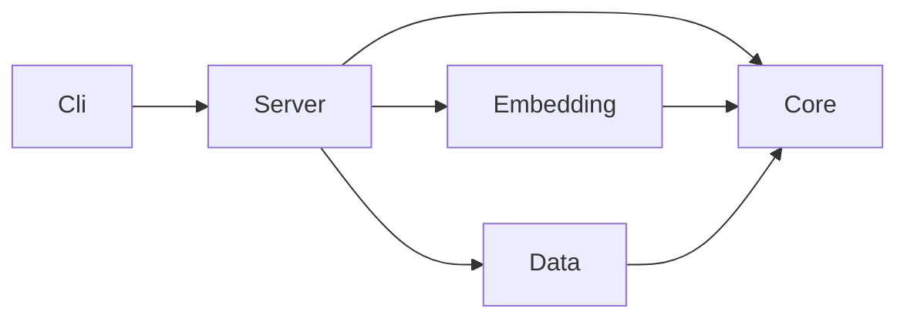
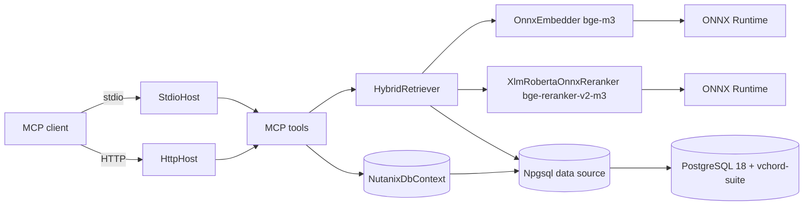
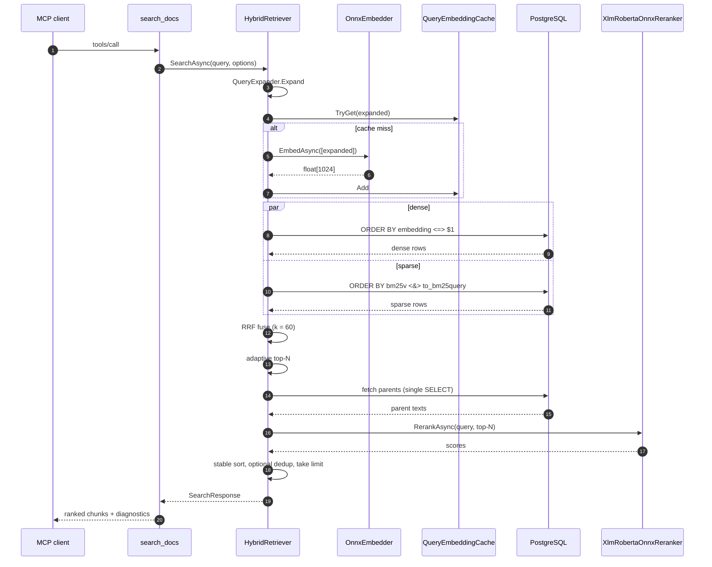

# Architecture

## Project layering

The .NET 10 solution enforces a strict reference graph. `Cli` depends on
`Server`. `Server` depends on `Core`. `Embedding` and `Data` also depend
on `Core` and may not see each other. `Core` depends only on the BCL.
Test projects are allowed to reference any layer.

| Project | Role |
|---|---|
| `NutanixMcp.Core` | Domain models, retrieval primitives, settings, model paths. No external deps beyond the BCL. |
| `NutanixMcp.Data` | EF Core 9.0.15, Npgsql binary COPY, repositories. Owns migrations. |
| `NutanixMcp.Embedding` | ONNX Runtime, SentencePiece tokenizer, embedder and reranker implementations. |
| `NutanixMcp.Server` | MCP tool surface, hybrid retriever, hosting (stdio and HTTP). |
| `NutanixMcp.Cli` | `nutanix-mcp` executable; entry verbs include `serve`. |

## Runtime topology

## Storage

PostgreSQL ships from the `tensorchord/vchord-suite:pg18-latest` base
image. The container loads `vector`, `vchord`, `vchord_bm25`, and
`pg_tokenizer` via `shared_preload_libraries`. The `init.sql` script
creates the extensions, sets the search path to include
`tokenizer_catalog` and `bm25_catalog`, tunes HNSW with
`iterative_scan = relaxed_order`, `max_scan_tuples = 20000`, and
`ef_search = 100`, and registers the `english_analyzer` text analyzer
(stopwords from `nltk_english`, Porter2 stemmer).

Three tables hold corpus state:

| Table | Purpose |
|---|---|
| `documents` | One row per source document. Carries category, product, version, slug, page count, and the optional `kb_number` for KB articles. |
| `chunks` | One row per chunk. Embedding is stored as `halfvec(1024)`. Parent rows carry `chunk_kind = 'parent'` with NULL embedding; leaves carry `chunk_kind = 'leaf'` and the `parent_chunk_id` foreign key. The BM25 trigger writes `bm25v` on insert and update. |
| `ingest_runs` | One row per ingest invocation, with `started_at`, `finished_at`, `status`, and counts. |

Indexes:

- HNSW on `chunks.embedding` with `m = 16`, `ef_construction = 200`,
  operator class `halfvec_cosine_ops`.
- BM25 on `chunks.bm25v` (`idx_chunks_bm25 USING bm25 (bm25v bm25_ops)`).
- Partial unique index on `documents.kb_number` for KB lookup.
- Composite index on `documents (category, product, version)`.

## Retrieval data flow

A single `search_docs` call follows the steps below.

The retriever emits per-stage timings in `SearchDiagnostics` so callers
can attribute slowdowns. There is no HyDE path, no rule-based multi-query
expansion, and no listwise re-rank — the rationale is recorded in
[`training-rag.md`](./training-rag.md).

## Tooling versions

| Component | Pinned version | Rationale |
|---|---|---|
| .NET SDK | 10.0.201 | TFM `net10.0`. |
| EF Core | 9.0.15 | `Pgvector.EntityFrameworkCore` 0.3.0 transitively pulls 9.0.1; direct pin to 9.0.15 wins. |
| Npgsql.EFCore | 9.0.4 | Matches EF 9. |
| pgvector | 0.8.2 | Bundled by `vchord-suite:pg18-latest`. |
| vchord | 1.1.1 | Bundled. |
| vchord_bm25 | 0.3.0 | Bundled. |
| pg_tokenizer | 0.1.1 | Bundled. |
| ModelContextProtocol | 1.2.0 | MCP SDK. |
| Microsoft.ML.OnnxRuntime | 1.24.4 | CPU. GPU build switches to `*.Gpu` via `-p:UseGpuOnnx=true`. |
| Microsoft.ML.Tokenizers | 2.0.0 | Loads SentencePiece via `SentencePieceTokenizer.Create`. |
| `bge-m3` | from BAAI on Hugging Face | Embedder ONNX, external-data layout (`model.onnx` plus `model.onnx_data`). |
| `bge-reranker-v2-m3` | from `hooman650/bge-reranker-v2-m3-onnx-o4` | Optimum-O4 ONNX export, FP32. |
