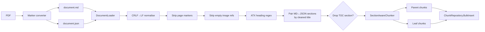

# Chunking strategy

The chunker turns each MD-plus-JSON pair from the converter into a list
of parent chunks (one per section) and a list of leaf chunks (sliding
windows over each section's body). Parents carry the full section body
and never embed; leaves embed and surface in dense retrieval.

## Pipeline

## Document loader

The loader normalises CRLF to LF before any regex runs — Windows-written
MD files silently collapse to a single section if `[^\r\n]+$` is matched
in multi-line mode without that step. After normalisation the loader:

1. Strips marker page-break tokens (`{N}-+`).
2. Strips empty image references that do not contribute to retrieval
   (`_M.ext)`).
3. Splits on ATX headings via
   `^(?<level>#{1,6})[ \t]+(?<title>[^\r\n]+)$` in multi-line mode.
4. Pairs MD sections to JSON sections by cleaned-title sequence with a
   lookahead window of three. Heading level is ignored on this side
   because the converter emits flat level-1 entries while MD keeps
   real depth.
5. Drops the table-of-contents section when the first level-2 heading
   matches `Contents`, `Table of Contents`, or `Содержание`.

`CleanHeading` strips `<tag>`, `**bold**`, `*italic*`, `_underscore_`,
and collapses runs of whitespace.

## Section sizes

| Parameter | Value | Notes |
|---|---|---|
| `TargetTokens` | 512 | bge-m3 sweet spot; same as the upstream Snowflake Arctic recipe. |
| `MaxTokens` | 1200 | Single-leaf cap before a section is sliced. |
| `OverlapTokens` | 64 | Sliding window overlap. |
| `MinTokens` | 40 | Below this, a leaf merges into its predecessor. |
| `ParentMaxTokens` | 2048 | Reranker context budget. |
| `ParentHeadTokens` | 1792 | Head allocation when a section exceeds the budget. |
| `ParentTailTokens` | 256 | Tail allocation. |

Tokens are approximated as `words × 1.3` until the bge-m3 SentencePiece
tokenizer is wired into the calibration loop.

## Per-corpus rules

| Corpus slice | Detection | Chunking |
|---|---|---|
| KB articles | `size_bytes < 10_000` and `section_count ≤ 3` | One whole-document leaf when total tokens ≤ 512, otherwise the default sliding window. Parent equals whole document. |
| Hardware replacement procedures | `category == 'hardware-replacement'` or slug contains `Replacement` | Default per-section recipe; parents emitted for the L2 procedure header. |
| Admin and reference guides | Default | Default per-section recipe. |
| API reference | `title.Contains('API Reference')` or `EndsWith('Reference')` and `pages > 200` | One leaf per L3 endpoint; no parent (a doc-wide parent has no useful signal for the cross-encoder). |
| Multi-version corpus | `documents.version` populated | Default chunking; the query side filters on version when the user requests one. |

## Multi-version handling

Nutanix ships near-identical guides for multiple AOS or AHV releases.
Three sets of overlapping chunks (for example, `AHV-Admin-v10_0`,
`v10_3`, `v11_0`) coexist in the corpus by design.

The `search_docs` MCP tool exposes a `version` argument. When set, the
SQL filter pins results to that release line. When unset, callers see
results from all versions; downstream tie-breaking on equal scores
should prefer the most recent version when the user has not asked
otherwise.

## Calibration plan

Once the bge-m3 tokenizer is callable from the chunker, sample 100
documents across all four size buckets and measure the tokens-per-word
ratio. If it diverges from 1.3 by more than ten percent, update
`ChunkingOptions.TargetTokens` for the affected bucket.

The calibration result is recorded in the sprint that runs it; the
chunker itself never embeds bench-derived constants.
