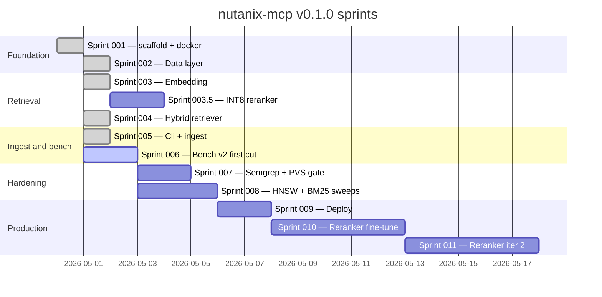

# Roadmap

The project ships in waterfall sprints. Each sprint has an explicit
acceptance criterion and a `git tag sprint-NNN-review` marker once it
passes. Sprints listed here as DONE have shipped on `main`.

## Sprint timeline

## Status

| Sprint | Status | Key artefacts |
|---|---|---|
| 001 | DONE | Solution skeleton, package pinning, docker stack, init.sql with `english_analyzer`. |
| 002 | DONE | EF entities, repositories, `PgvectorFixture`, `Initial` and `AddBm25Column` migrations. 9/9 Data tests green. |
| 003 | DONE | bge-m3 embedder, bge-reranker-v2-m3 reranker, `RerankerFamilyDetector`, model fetch script. 15/15 Embedding tests green. |
| 003.5 | Queued | INT8 reranker via Optimum O4. Merge gate: at most 1 pp top-1 regression versus FP32. |
| 004 | DONE | `HybridRetriever`, 7 MCP tools, stdio + HTTP hosts, `serve` Cli verb. 37/37 tests green plus live HTTP smoke. |
| 005 | DONE | `CatalogReader`, `DocumentLoader` (CRLF/marker/TOC strip, MD↔JSON pair), `SectionAwareChunker`, `IngestService`, `ingest` Cli verb. 52/52 tests green; live ingest + MCP search verified. |
| 006 | DONE | Bench v2 harness + history. ntx-mcp quality stack adopted. Code-review fixes merged. 3-platform throughput study (1.7/13.7/634 chunks/s). Remote ingest of 7343 documents complete (2026-05-01). 38-query first-cut fixture authored via `scripts/seed-bench-queries.ps1`. Acceptance gate PASSED: top-10 = 81.6 %. Six iterations recorded in `bench-history.jsonl`. |
| 007 | Partially landed | `scripts/pvs-studio-scan.ps1` runs locally (slnx unsupported, iterates csproj). Pending: Semgrep job and PVS-Studio CI job. `markdownlint-cli2` job already lives in `ci.yml`. |
| 008 | Pending | HNSW and BM25 sweeps recorded in `bench-history.jsonl`. |
| 009 | Pending | Single-file publish for Windows, Linux, macOS on amd64 and arm64. Systemd unit and Windows service templates. |
| 010 | Pending | Cross-encoder fine-tune iteration 1 against curated triples. |
| 011 | Pending | Fine-tune iteration 2 with production-log hard negatives. |

## Key decisions and dependencies

| Decision | Driver | Recorded in |
|---|---|---|
| Use `halfvec(1024)` for `chunks.embedding` | Half precision halves storage at negligible recall cost. | [`architecture.md`](./architecture.md) |
| Pin EF Core to 9.0.15 | `Pgvector.EntityFrameworkCore` 0.3.0 transitively pulls 9.0.1; direct override is required. | [`architecture.md`](./architecture.md) |
| Postgres on port 5435 | Coexistence with the upstream `arista-mcp` deployment on 5434. | [`quickstart.md`](./quickstart.md) |
| HyDE, multi-query, listwise excluded from v0.1 | All three regressed on the upstream bench. | [`training-rag.md`](./training-rag.md) |
| Bench v2 from day one | Bench v1 substring scoring masked three real regressions on the upstream line. | [`training-rag.md`](./training-rag.md) |
| `pg_textsearch` BM25 swap deferred | Hold the v2-m3 win recipe constant; A/B against the swap when bench infrastructure is ready. | [`training-rag.md`](./training-rag.md) |
