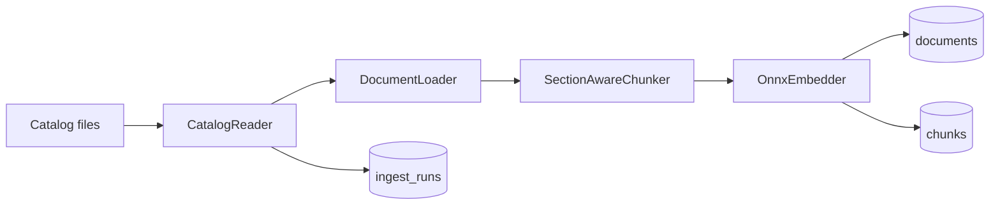

# Sprint 005 — CLI + ingest pipeline

Status: in progress. Goal: turn the 7343 converted MD/JSON pairs into a
populated PostgreSQL store backing the `search_docs` MCP tool.

## Corpus audit (2026-05-01, 7343 documents)

The local snapshot at `C:\SHARE\nutanix-docs-mcp\data\converted\` was
cataloged before the loader and chunker were finalised. The findings
below shape the design of those components.

### Size buckets

| Bucket | Files | Total |
|---|---|---|
| under 5 KB | 4310 | 10.4 MB |
| 5–20 KB | 1500 | 13.1 MB |
| 20–100 KB | 1270 | 56.8 MB |
| 100–500 KB | 172 | 35.7 MB |
| 500 KB – 2 MB | 84 | 66.7 MB |
| over 2 MB | 7 | 20.5 MB |

KB articles dominate the under-5-KB tier. The over-2-MB tier holds the
API reference and the largest admin guides.

### Heading and content health

| Metric | Value | Loader response |
|---|---|---|
| Documents with at least one ATX heading | 7343 / 7343 | OK; the loader's heading regex is sufficient. |
| Documents under 200 characters | 0 | OK; no ingest skip needed. |
| Documents with CRLF line endings | 5958 / 7343 (81 %) | The loader normalises CRLF to LF before any regex runs (the rule is recorded in `docs/en/chunking.md`). |
| Documents with surviving marker page tokens (`{N}---`) | 1783 / 7343 (24 %) | The loader strips them via `\{\d+\}-+`. |
| Documents with empty marker image refs (``) | 1782 / 7343 (24 %) | The loader strips them. |
| Documents that start with a `## **Contents**` table | 1145 / 7343 (16 %) | The loader drops the table-of-contents section. |
| Duplicate document stems | 0 | The catalog reader can use the stem as primary key. |
| Headings flagged as long or unusual | 297 | Acceptable noise — most are legitimate (API endpoint URLs, VM info panels, log messages mistakenly emitted as headings). |

### JSON enrichment shapes

| Shape | Files | Sections payload | Loader behaviour |
|---|---|---|---|
| `dict-list` with `{title, page}` per section | 5489 (75 %) | Authoritative source for page numbers. | Use for MD↔JSON pairing via cleaned-title sequence. |
| `string-list` (just section titles) | 84 (1 %) | No page numbers. | Use as a sanity check; fall back to MD-only paging. |
| Empty (`sections: []`, `toc: []`) | 1770 (24 %) | No enrichment. | Pure MD-only loader path. |

The `dict-list` JSON also exposes `block_stats` (counts of every block
type the converter saw) and a flat `sections` string list alongside the
`toc` dict list. The loader prefers `toc` for the page mapping because
it carries `heading_level` and `page` per entry.

## Acceptance gate for Sprint 005

The sprint passes when:

- The CLI ships an `ingest` verb that walks the local catalog,
  populates `documents` and `chunks` tables, and writes an
  `ingest_runs` row with the final counts.
- `dotnet test` is green across all five test projects.
- A full ingest of the 7343-document corpus completes successfully on
  the developer machine. Numbers are recorded in this document.
- `get_status` over the live server returns `documents > 0` and
  `chunks > 0` against the populated `nutanix` database.

## Pipeline shape

Components and responsibilities:

| Component | Lives in | Responsibility |
|---|---|---|
| `CatalogReader` | `Core.Catalog` | Walk `data/converted/{md,json}`, emit `CatalogEntry` per stem. |
| `DocumentLoader` | `Core.Catalog` | CRLF normalise, strip page markers and empty image refs, drop TOC, parse ATX headings, pair MD↔JSON sections, return `LoadedDocument`. |
| `SectionAwareChunker` | `Core.Chunking` | Emit one parent and 1+ leaves per section per the recipe in `docs/en/chunking.md`. |
| `IngestService` | `Cli.Ingest` | Orchestrate per-document: skip on `pdf_sha256` match, embed leaves, bulk-insert parents+leaves, advance `ingest_runs`. |
| CLI `ingest` verb | `Cli.Commands` | Wire `IngestService` to `CliConfiguration` and Spectre.Console progress. |

## Test plan

- `CatalogReaderTest` — finds all 7343 stems on the local snapshot,
  zero duplicates, JSON optional.
- `DocumentLoaderTest` — fixtures exercise CRLF normalise, marker-strip,
  TOC drop, MD↔JSON dict-list pair, MD↔JSON string-list pair,
  MD-only fallback, and the long-title canary.
- `SectionAwareChunkerTest` — parents emitted per section, leaf
  splitting at boundary, tiny-neighbour merge confined per section.
- `IngestServiceTest` — happy path, sha-skip path, partial-failure
  path (one chunk fails, rest succeed).

## Open follow-ups

- Bench v2 fixture (Sprint 006) needs a curated 100-query JSON. Stems
  with `kb-` prefix help author KB-pinned queries.
- The 24 % of documents with no JSON enrichment lose page numbers;
  consider a one-off enrichment pass via `marker` later.
