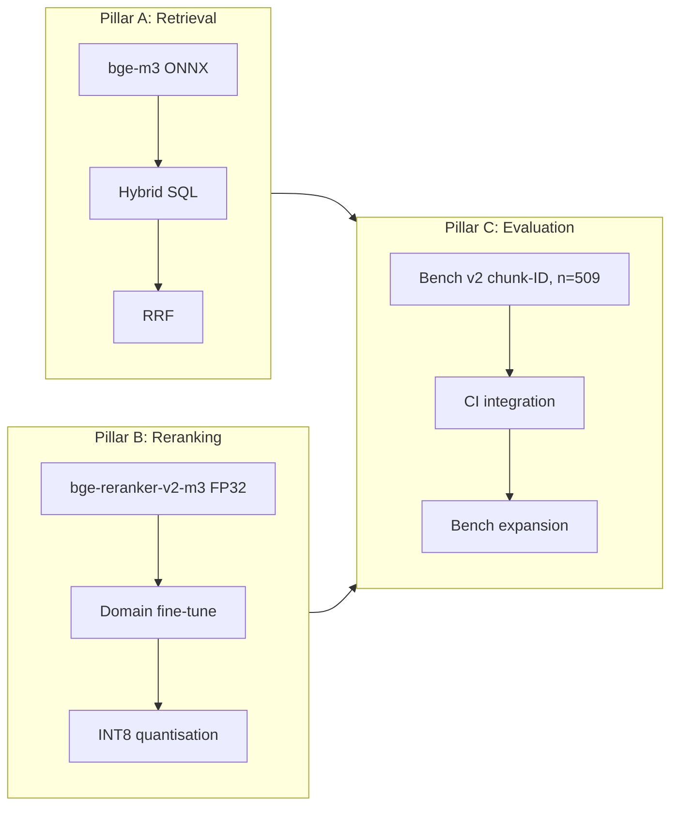

# Training and RAG roadmap

The retrieval quality plan splits into three pillars: dense plus sparse
retrieval (pillar A), cross-encoder reranking (pillar B), and evaluation
(pillar C). Pillars A and B ship hyperparameters; pillar C ships the
benchmark that gates them.

## Pillars at a glance



## Pillar A: retrieval

The dense path uses bge-m3 with no query prefix. The sparse path uses
vchord_bm25 with the `english_analyzer` configuration (NLTK English
stopwords plus the Porter2 stemmer). RRF fuses the two sides at
`k = 60`. HNSW is configured with `m = 16`, `ef_construction = 200`,
`ef_search = 100`, and `iterative_scan = relaxed_order`.

### Sprint 008 sweep (DONE 2026-05-02)

A one-at-a-time sweep across the four tunable knobs confirmed the
default values are already at the quality-vs-latency sweet spot on the
207-q first-cut fixture. Sub-pp deltas live below the n=207 noise
floor:

| Sweep | Result |
|---|---|
| `ef_search` ∈ {50, 100, 200, 400} | top-1 flat at 82.6 %, p95 ±5 % |
| `iterative_scan` strict vs relaxed | indistinguishable |
| `rrf_k` 30 vs 60 | tail latency doubles for k=30 (avoid) |
| `rrf_k` 100 vs 60 | -0.5 pp top-1 (avoid) |
| `pool=30` vs 50 | -1.9 pp top-1, top-10 below 100 % (avoid) |
| `pool=100` vs 50 | -1.0 pp top-1 + 12 % p95 (avoid) |

See [`sprints/sprint-008.md`](./sprints/sprint-008.md). The
`m`-rebuild row stayed queued — gated on a fixture where ef_search
isn't already saturating recall.

## Pillar B: reranking

`bge-reranker-v2-m3` ships in Sprint 003 as an Optimum-O4 ONNX export.
Sprint 010 produced a fine-tuned variant; Sprint 003.5 quantised the
result to INT8.

### Sprint 010 — fine-tune iter 1 (DONE 2026-05-02)

Recipe locked to the upstream arista win record:

| Component | Value |
|---|---|
| Base model | `BAAI/bge-reranker-v2-m3` (XLM-R, 568M, FP32) |
| Triples | 4137 (q, passage, label), bge-m3 hard-neg mining |
| Mining guard | All `expect_chunk_ids` (multi-positive) excluded from negatives |
| Loss | `BinaryCrossEntropyLoss(pos_weight=8)` |
| Optim | AdamW, lr=2e-5, warmup_ratio=0.1 |
| Batch | 16 / device, single 5090 |
| Seq | 512 |
| Epochs | 3 (669 train steps) |
| Holdout | query-hash 15 % (~64 queries), NDCG@10 metric |

Best epoch (3) NDCG@10 = **0.9942** on the holdout.

Production bench delta (509-q LLM fixture):

| Metric | v0.2.0 stock FP32 | **v0.3.0 fine-tune FP32** | Δ |
|---|---:|---:|---:|
| top-1 | 79.0 % | **80.6 %** | **+1.6 pp** |
| top-5 | 99.0 % | 99.4 % | +0.4 pp |
| top-10 | 100.0 % | 100.0 % | flat |
| p50 (ms) | 2625 | 2737 | +4 % |
| p95 (ms) | 3675 | 3915 | +7 % |

See [`sprints/sprint-010.md`](./sprints/sprint-010.md).

### Sprint 003.5 — INT8 quantisation (DONE 2026-05-02)

Dynamic INT8 quantisation of the FP32 fine-tune ONNX via
`onnxruntime.quantization.quantize_dynamic`. The original blocker (the
FP16-source community export couldn't quantise — `DynamicQuantizeLinear`
rejected FP16 inputs) is bypassed because the fine-tune produces a
clean FP32 ONNX through `optimum.exporters.onnx`.

| Metric | FP32 fine-tune | **INT8 fine-tune** | Δ |
|---|---:|---:|---:|
| top-1 | 80.6 % | **80.2 %** | -0.4 pp (within ≤1 pp gate) |
| top-5 | 99.4 % | 99.6 % | +0.2 pp |
| top-10 | 100.0 % | 100.0 % | flat |
| p50 (ms) | 2737 | **2014** | **-26 %** |
| p95 (ms) | 3915 | **2930** | **-25 %** |
| Disk | 2.17 GB | **1.30 GB** | **-40 %** |

Acceptance gate (≤1 pp top-1 regression + measurable p95 improvement)
PASSED. INT8 is the recommended production deployment for CPU-only
laptops — AVX-VNNI lights up at session-init.

### Sprint 011 — fine-tune iter 2 (queued)

Curated hard negatives from production query logs (anonymised,
four-week window). Merge gate: top-1 improvement of at least one
percentage point with no top-10 regression. Blocked on a deployed
user base producing real query logs.

### v0.4.0 — Qwen3 swap (queued, scoped)

Qwen3-Embedding-0.6B and Qwen3-Reranker-0.6B (Apache-2.0, ~+5 pp
MTEB-multilingual / +5 pp BEIR-rerank vs the bge lineage) are
candidates for a v0.4.0 swap. Not a drop-in: decoder-only
architecture, Qwen BPE tokenizer (vs SentencePiece), instruct-prefix
prompts, last-token / generative scoring. Estimated cost ~6-8 hours
of refactor + a re-ingest of 489 K chunks. Tracked separately from
the v0.3.x line.

## Pillar C: evaluation

Bench v2 keys on chunk-ID gold labels from day one. The fixture is
LLM-generated rather than hand-curated — see
[`sprints/sprint-006.md`](./sprints/sprint-006.md) for the pipeline:

```
sample 500 chunks
  → LLM-generate 1-2 questions per chunk (Qwen2.5-3B)
  → fairness filter via the live retriever (top-K=20)
  → multi-positive annotation by the same LLM
  → final 509-query fixture
```

Live category distribution in the fixture: `kb` (~14 % of seed but
75 % of corpus → over-sampled away from corpus dominance via
stratified quotas), `hardware-replacement`, `other`, `prism-central`,
`prism-element`, `ahv`, `aos`, `bible` (Nutanix Bible),
`api`, `files`, `ports`. The 16 categories the original plan named
included six (`ndb`, `kubernetes`, `flow`, `move`,
`disaster-recovery`, `cloud-clusters`, `nki`, `pulse`, `lcm`)
that the live corpus does not actually contain — the fixture honours
real corpus shape.

Each row carries:

```json
{
  "query_id": "q-0042",
  "query": "How do I configure VLAN tagging on AHV virtual switch?",
  "expect_chunk_ids": [102, 487, 1234],
  "expect_doc": "AHV-Admin-Guide-v11_0",
  "expect_section": "...",
  "expect_product": null,
  "category": "ahv",
  "difficulty": "easy"
}
```

`expect_chunk_ids` is the union of acceptable hits — the source
chunk plus everything the LLM annotator labelled as a valid answer
from the retriever's top-10. Top-N counts a query as a hit if any
acceptable chunk appears in the first N results.

`expect_product` stays null because the ingest pipeline never
populates `documents.product` for the Nutanix corpus.

Bench history persists to `tests/fixtures/bench-history.jsonl`,
append-only, one row per `bench` invocation:

```json
{
  "timestamp": "2026-05-02T...",
  "label": "v0.3.0-finetune-int8",
  "git_sha": "...",
  "queries": 509,
  "top_1": 0.802,
  "top_5": 0.996,
  "top_10": 1.0,
  "p50_ms": 2014,
  "p95_ms": 2930,
  "embedder": "bge-m3",
  "reranker": "bge-reranker-v2-m3",
  "rrf_k": 60,
  "rerank_top_n": 30,
  "candidate_pool_size": 50,
  "limit": 10,
  "ef_search": 100,
  "iterative_scan": "relaxed_order",
  "reranker_dir": "models/reranker-finetuned-int8"
}
```

The Sprint 008 sweep adds the `ef_search`, `iterative_scan`, and
`reranker_dir` optional fields. Older rows omit them and stay
schema-clean — `BenchRun` makes them nullable.

### Statistical significance

At `n = 509`, a 1 pp delta is roughly 0.45σ — borderline detectable.
A 3 pp delta is ~1.4σ. Declaring a sub-1-pp win significant requires
`n ≥ 1500`. **Top-10 saturated at 100 %** on the present fixture
distribution — that's a measurement ceiling, not a quality plateau.
Breaking it requires either (a) harder LLM-generated queries
(paraphrase, cross-doc, terminology drift) or (b) seeding from
unique-rare-term documents.

## Operational notes from arista-mcp

The upstream `arista-mcp` line ran a similar bench-then-tune loop on a
much smaller corpus (~159 documents). Three lessons we inherited
directly:

1. **Reingest invalidates the bench.** Every full reingest reassigns
   `chunks.id`, so any chunk-pinned bench fixture drifts. Author the
   bench against a stable corpus snapshot, re-pin via
   `validate-bench-queries` after each reingest, and never run a
   sprint acceptance gate immediately after a reingest without first
   re-running the bench.
2. **Top-1 plateaus before top-10 does.** Five levers in the upstream
   line converged at 72-74 % top-1 and 99.10 % top-10 on a 588-query
   bench. Our fixture matches the pattern — top-10 ceiling at 100 %
   on n=509, top-1 movements are the lever.
3. **CPU-only ingest is expensive at scale.** Arista's full-corpus
   run was ~25 minutes on CPU for 159 documents — Nutanix's 7343
   docs take ~2 hours on a laptop CPU vs ~13 min on a single 5090
   (per Sprint 006 throughput study). Document ingest cost in every
   sprint that re-ingests so reviewers can plan the bench window.

## CI gating

| Job | Trigger | Behaviour |
|---|---|---|
| `build-and-unit-test` | Every push to main + PR | `dotnet test` excluding the Pgvector collection. |
| `integration-test` | Every push to main + PR | `dotnet test` against a Postgres service container with vchord-suite + init.sql. |
| `docs-lint` | Every push to main + PR | `markdownlint-cli2` on all `*.md`. |
| `semgrep` | Every push to main + PR | `semgrep scan --config=auto --error` on `src/`. |
| `pvs-studio` | Push to main (gated on license secret) | PVS-Studio C# scan; skipped on forked-PR pushes that lack `${{ secrets.PVS_USER }}`. |

Bench-as-CI is queued but not active — running a full bench needs
the populated PG, which our CI Postgres service container is not
(it's an empty `nutanix_test` for unit tests). Bench is a manual
acceptance step today, run on a populated dev/staging PG.

## Levers excluded from v0.3.0

- **Embedder fine-tune.** Bge-m3's multilingual prior is the
  user-stated requirement (Russian queries against an English
  corpus). A meaningful nutanix-specific embedder training set would
  require ingesting customer logs that this project does not have.
- **HyDE rewriting and listwise re-rank.** Both regressed on the
  upstream bench. Re-evaluate when a frontier-class local LLM is
  reachable.
- **Multi-query expansion.** Regressed on the upstream bench.
  Memory entry: `feedback_multiquery_regression`.
- **`pg_textsearch` (Tapir) BM25 swap.** Tracked as a v0.4.x
  candidate experiment. The merge gate is a p95 reduction at
  constant or improved top-1 recall on bench v2.
