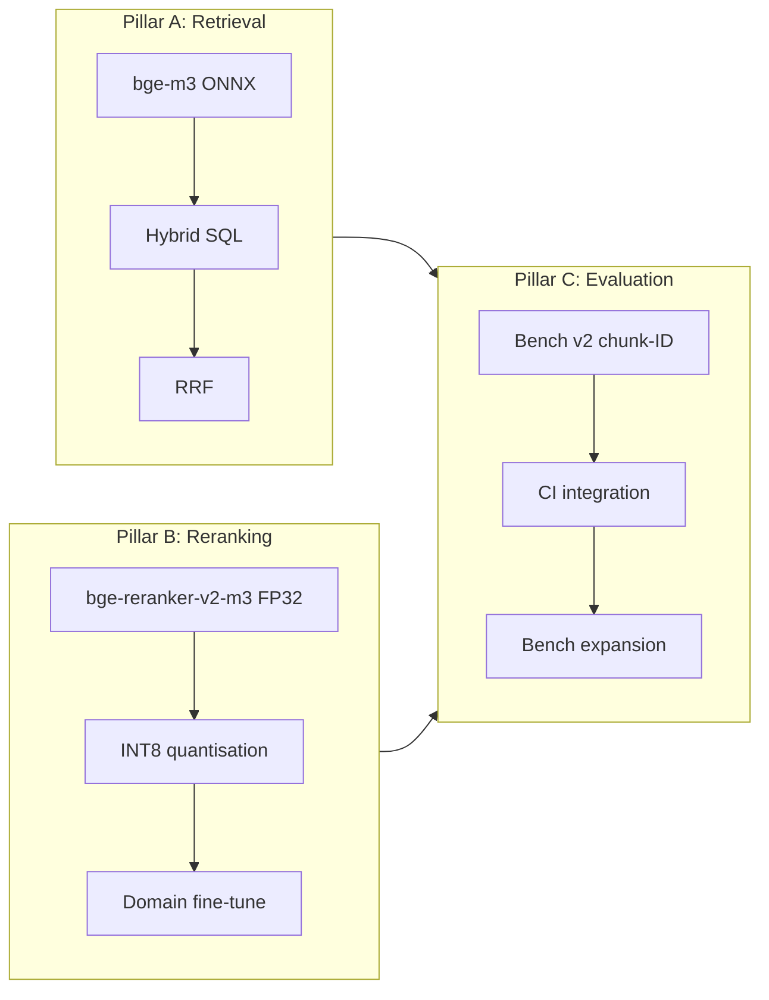

# Training and RAG roadmap

The retrieval quality plan splits into three pillars: dense plus sparse
retrieval (pillar A), cross-encoder reranking (pillar B), and evaluation
(pillar C). Pillars A and B ship hyperparameters; pillar C ships the
benchmark that gates them.

## Pillars at a glance



## Pillar A: retrieval

The dense path uses bge-m3 with no query prefix. The sparse path uses
vchord_bm25 with the `english_analyzer` configuration (NLTK English
stopwords plus the Porter2 stemmer). RRF fuses the two sides at
`k = 60`. HNSW is configured with `m = 16`, `ef_construction = 200`,
`ef_search = 100`, and `iterative_scan = relaxed_order`.

Sweeps queued for Sprint 008:

| Sweep | Grid | Hypothesis |
|---|---|---|
| `ef_search` | 50, 100, 200, 400 | Top-10 improves at the cost of p95 latency. |
| `m` (rebuild required) | 16, 32, 48 | Recall improves on rare-token queries. |
| `RrfK` | 30, 60, 100 | Sparse-only-hit weighting trade-off. |
| `iterative_scan` | `strict_order` vs `relaxed_order` | Latency floor. |

## Pillar B: reranking

`bge-reranker-v2-m3` ships in Sprint 003 as an Optimum-O4 ONNX export
in FP32. INT8 quantisation via `optimum-cli onnxruntime quantize
--avx512_vnni` is queued for Sprint 003.5; the merge gate is at most
1 percentage point top-1 regression versus FP32 with measurable p95
improvement.

Domain fine-tune (Sprint 010) replicates the upstream v2-m3 recipe with
nutanix-specific triples:

1. Curate triples via `nutanix-mcp curate-triples`. Hard-negative filter:
   positive and negative differ in both document and product.
2. Target 4000 to 6000 (q, pos, neg) triples.
3. Hyperparameters locked to the upstream win recipe — backbone XLM-R
   568M, BCE loss with `pos_weight = 8`, multi-positive mining,
   learning rate 2e-5, batch 32, three epochs, warmup 0.06, mixed
   precision.
4. Export ONNX, quantise to INT8 with avx512_vnni.
5. Acceptance gate: top-1 improvement of at least three percentage
   points over the FP32 off-the-shelf reranker.

A second iteration (Sprint 011) folds in curated hard negatives from
production query logs (anonymised, four-week window). Merge gate: top-1
improvement of at least one percentage point with no top-10 regression.

## Pillar C: evaluation

Bench v2 starts with chunk-ID gold labels from day one. The query
budget at first cut is 100 hand-curated queries spread across all
sixteen categories: `ahv`, `aos`, `kb`, `files`, `ndb`, `kubernetes`,
`flow`, `prism-central`, `prism-element`, `move`, `disaster-recovery`,
`cloud-clusters`, `nki`, `pulse`, `lcm`, `hardware-replacement`. Mix:
fifty percent easy (verbatim term match), thirty percent medium
(paraphrased), twenty percent hard (cross-document or terminology
drift).

Schema:

```json
{
  "query_id": "ahv-vlan-001",
  "query": "How do I configure a VLAN on AHV virtual switch?",
  "expect_chunk_ids": [102, 487, 1234],
  "expect_doc": "AHV-Admin-Guide-v11_0",
  "expect_section": "AHV Virtual Switch VLAN Configuration",
  "expect_product": "ahv",
  "category": "ahv",
  "difficulty": "easy"
}
```

`expect_chunk_ids` is the union of acceptable hits. Top-N counts a query
as a hit if any acceptable chunk appears in the first N results.

Bench history persists to `tests/fixtures/bench-history.jsonl`,
append-only, one row per `bench` invocation:

```json
{
  "timestamp": "2026-05-12T10:00:00Z",
  "label": "v0.2.0",
  "queries": 100,
  "top_1": 0.82,
  "top_5": 0.94,
  "top_10": 0.97,
  "p50_ms": 1450,
  "p95_ms": 2300,
  "embedder": "bge-m3",
  "reranker": "bge-reranker-v2-m3-fp32",
  "rrf_k": 60,
  "ef_search": 100,
  "rerank_top_n": 30,
  "git_sha": "abc123"
}
```

Significance threshold: at `n = 100`, a five percentage-point delta is
about one sigma. Declaring a sub-3-pp win significant requires
`n ≥ 300`. The bench expansion to that scale is contingent on top-10
saturation; the upstream bench saw the wall at 99.10 percent on 588
queries.

## Operational notes from arista-mcp

The upstream `arista-mcp` line ran a similar bench-then-tune loop on a
much smaller corpus (~159 documents). Three lessons we are inheriting
directly:

1. **Reingest invalidates the bench.** Every full reingest reassigns
   `chunks.id`, so any chunk-pinned bench fixture drifts. Author the
   bench against a stable corpus snapshot, re-pin via
   `validate-bench-queries` after each reingest, and never run a sprint
   acceptance gate immediately after a reingest without first
   re-running the bench.
2. **Top-1 plateaus before top-10 does.** Five levers in the upstream
   line converged at 72-74 % top-1 and 99.10 % top-10 on a 570-query
   bench. Once top-10 saturates, every later sprint must expand the
   bench before adding more levers.
3. **CPU-only ingest is expensive at scale.** Arista's full-corpus run
   was about 25 minutes on CPU for 159 documents — Nutanix's 7343 docs
   take roughly two hours on the same hardware path. The GPU build
   (`-p:UseGpuOnnx=true`) brings that under 15 minutes on a 4070.
   Document ingest cost in every sprint that re-ingests so reviewers
   can plan the bench window.

## CI gating

| Job | Trigger | Behaviour |
|---|---|---|
| `unit` | Every PR | `dotnet test` excluding the Pgvector collection. |
| `integration` | Every PR | `dotnet test` against a `nutanix_test` PostgreSQL. |
| `bench-smoke` | Every PR with the `bench` label | 30-query smoke set; fails the build if top-10 drops below 80 percent. |
| `bench-full` | Weekly cron | 100-plus queries, append to `bench-history.jsonl`, post the diff to a tracking issue. |

## Levers excluded from v0.1

- Embedder fine-tune. The upstream line did not try it; bge-m3's
  multilingual prior is the user-stated requirement (Russian queries
  against an English corpus). A meaningful nutanix-specific embedder
  training set would require ingesting customer logs that this project
  does not have.
- HyDE rewriting and listwise re-rank. Both regressed on the upstream
  bench. Re-evaluate when a frontier-class local LLM is reachable.
- `pg_textsearch` (Tapir) BM25 swap. Tracked as a v0.2 or v0.3 candidate
  experiment in [`roadmap.md`](./roadmap.md). The merge gate is a p95
  reduction at constant or improved top-1 recall on bench v2.
