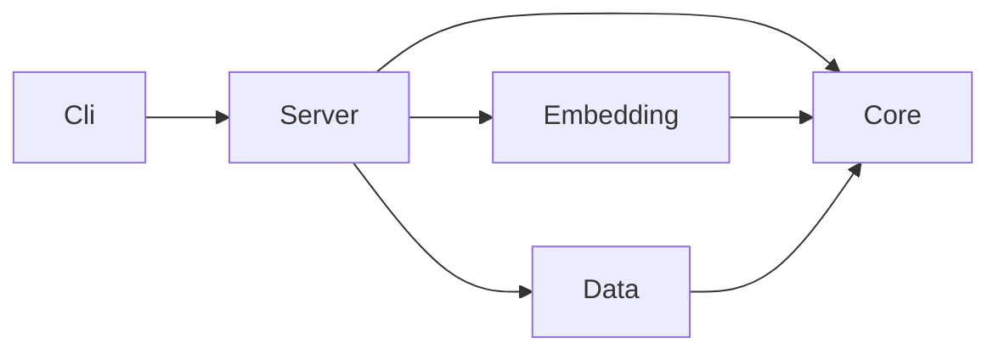
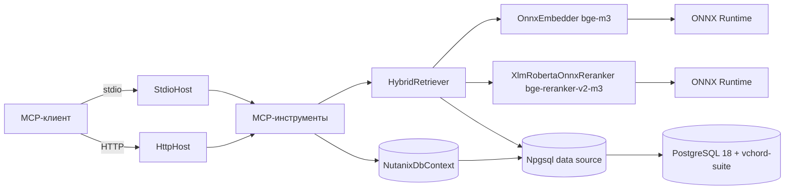
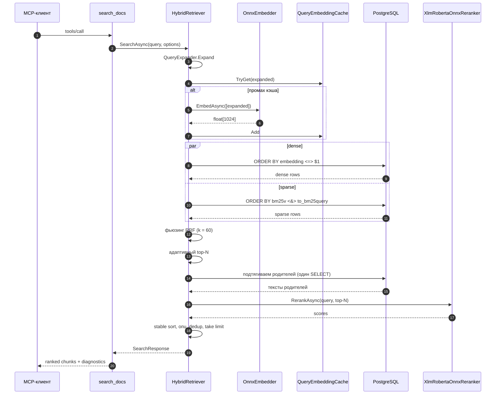

# Архитектура

## Слои проекта

Решение .NET 10 принудительно соблюдает граф ссылок. `Cli` зависит от
`Server`. `Server` зависит от `Core`. `Embedding` и `Data` тоже зависят
от `Core` и не видят друг друга. `Core` зависит только от BCL.
Тестовые проекты могут ссылаться на любой слой.

| Проект | Роль |
|---|---|
| `NutanixMcp.Core` | Доменные модели, примитивы поиска, настройки, пути моделей. Зависит только от BCL. |
| `NutanixMcp.Data` | EF Core 9.0.15, бинарный COPY от Npgsql, репозитории. Хранит миграции. |
| `NutanixMcp.Embedding` | ONNX Runtime, токенизатор SentencePiece, реализации эмбеддера и реранкера. |
| `NutanixMcp.Server` | Поверхность MCP-инструментов, гибридный ретривер, хостинг (stdio и HTTP). |
| `NutanixMcp.Cli` | Бинарник `nutanix-mcp`; глаголы CLI, среди них `serve`. |

## Топология рантайма

## Хранилище

PostgreSQL запускается из базового образа
`tensorchord/vchord-suite:pg18-latest`. Контейнер подгружает `vector`,
`vchord`, `vchord_bm25` и `pg_tokenizer` через `shared_preload_libraries`.
Скрипт `init.sql` создаёт расширения, добавляет в `search_path` схемы
`tokenizer_catalog` и `bm25_catalog`, тюнит HNSW
(`iterative_scan = relaxed_order`, `max_scan_tuples = 20000`,
`ef_search = 100`) и регистрирует анализатор `english_analyzer`
(стопслова `nltk_english`, стеммер Porter2).

Три таблицы хранят состояние корпуса:

| Таблица | Назначение |
|---|---|
| `documents` | Одна строка на исходный документ. Несёт category, product, version, slug, число страниц и опциональный `kb_number` для KB. |
| `chunks` | Одна строка на chunk. Эмбеддинг — `halfvec(1024)`. Родительские строки несут `chunk_kind = 'parent'` и NULL-эмбеддинг; листья — `chunk_kind = 'leaf'` и FK `parent_chunk_id`. Триггер BM25 пишет `bm25v` на INSERT/UPDATE. |
| `ingest_runs` | Одна строка на запуск ingest: `started_at`, `finished_at`, `status`, счётчики. |

Индексы:

- HNSW на `chunks.embedding` с `m = 16`, `ef_construction = 200`,
  оператор `halfvec_cosine_ops`.
- BM25 на `chunks.bm25v` (`idx_chunks_bm25 USING bm25 (bm25v bm25_ops)`).
- Частичный уникальный индекс на `documents.kb_number` для KB-lookup.
- Композитный индекс на `documents (category, product, version)`.

## Поток данных при поиске

Один вызов `search_docs` идёт по шагам ниже.

Ретривер пишет тайминги по стадиям в `SearchDiagnostics`, чтобы вызыватель
мог атрибутировать замедления. Тропы HyDE, multi-query и listwise
отсутствуют — мотивация в [`training-rag.md`](./training-rag.md).

## Версии инструментария

| Компонент | Версия | Причина |
|---|---|---|
| .NET SDK | 10.0.201 | TFM `net10.0`. |
| EF Core | 9.0.15 | `Pgvector.EntityFrameworkCore` 0.3.0 транзитивно тянет 9.0.1; прямой пин на 9.0.15 побеждает. |
| Npgsql.EFCore | 9.0.4 | Соответствует EF 9. |
| pgvector | 0.8.2 | Из `vchord-suite:pg18-latest`. |
| vchord | 1.1.1 | Из образа. |
| vchord_bm25 | 0.3.0 | Из образа. |
| pg_tokenizer | 0.1.1 | Из образа. |
| ModelContextProtocol | 1.2.0 | MCP SDK. |
| Microsoft.ML.OnnxRuntime | 1.24.4 | CPU. GPU-сборка переключается на `*.Gpu` через `-p:UseGpuOnnx=true`. |
| Microsoft.ML.Tokenizers | 2.0.0 | Загружает SentencePiece через `SentencePieceTokenizer.Create`. |
| `bge-m3` | от BAAI на Hugging Face | ONNX-эмбеддер, external-data layout (`model.onnx` + `model.onnx_data`). |
| `bge-reranker-v2-m3` | из `hooman650/bge-reranker-v2-m3-onnx-o4` | Optimum-O4 ONNX-экспорт, FP32. |
