# Стратегия чанкования

Чанкер превращает каждую пару MD + JSON от конвертера в список
родительских chunks (по одному на секцию) и список листьев (sliding
window по телу секции). Родители несут полное тело секции и не
эмбеддятся; листья эмбеддятся и всплывают в плотном поиске.

## Конвейер

```mermaid
flowchart LR
  pdf[PDF] --> conv[Marker конвертер]
  conv --> md[document.md]
  conv --> json[document.json]
  md --> loader[DocumentLoader]
  json --> loader
  loader --> norm[Нормализация CRLF→LF]
  norm --> stripPg[Снять page-маркеры]
  stripPg --> stripImg[Снять пустые image-ссылки]
  stripImg --> hdr[Регексп ATX-заголовка]
  hdr --> stamp[Спарить MD↔JSON по cleaned title]
  stamp --> tocskip{Дропнуть TOC?}
  tocskip --> chunker[SectionAwareChunker]
  chunker --> parents[Parent chunks]
  chunker --> leaves[Leaf chunks]
  parents --> ingest[ChunkRepository.BulkInsert]
  leaves --> ingest
```

## Загрузчик документов

Загрузчик нормализует CRLF в LF до любого regex — Windows-ные MD молча
схлопываются в одну секцию, если матчить `[^\r\n]+$` в multi-line без
этого. После нормализации:

1. Снимает marker-маркеры страниц (`{N}-+`).
2. Снимает пустые ссылки на изображения, которые не дают сигнал поиску
   (`_M.ext)`).
3. Бьёт по ATX-заголовкам:
   `^(?<level>#{1,6})[ \t]+(?<title>[^\r\n]+)$` в multi-line.
4. Парит MD-секции и JSON-секции по последовательности cleaned title с
   lookahead-окном 3. Уровень заголовка игнорируется: конвертер выдаёт
   плоские level-1, MD сохраняет реальную глубину.
5. Дропает оглавление, когда первый level-2-заголовок матчит `Contents`,
   `Table of Contents` или `Содержание`.

`CleanHeading` снимает `<tag>`, `**bold**`, `*italic*`, `_underscore_` и
схлопывает пробелы.

## Размеры секций

| Параметр | Значение | Замечания |
|---|---|---|
| `TargetTokens` | 512 | Sweet spot для bge-m3; зеркало рецепта upstream-Snowflake-Arctic. |
| `MaxTokens` | 1200 | Cap одного листа до того, как секция нарезается. |
| `OverlapTokens` | 64 | Перекрытие sliding window. |
| `MinTokens` | 40 | Ниже — лист сливается с предшественником. |
| `ParentMaxTokens` | 2048 | Контекстный бюджет реранкера. |
| `ParentHeadTokens` | 1792 | Голова при превышении бюджета. |
| `ParentTailTokens` | 256 | Хвост. |

Токены приближаются как `words × 1.3` до того, как SentencePiece-токенизатор
bge-m3 будет включён в калибровочный цикл.

## Правила по корпусным срезам

| Срез | Детектор | Чанкование |
|---|---|---|
| KB-статьи | `size_bytes < 10_000` и `section_count ≤ 3` | Один whole-document лист, если суммарных токенов ≤ 512, иначе обычный sliding window. Родитель = весь документ. |
| Hardware replacement | `category == 'hardware-replacement'` или slug содержит `Replacement` | Дефолтный per-section рецепт; родители для L2-заголовков процедур. |
| Admin и reference guides | По умолчанию | Дефолтный per-section рецепт. |
| API reference | `title.Contains('API Reference')` или `EndsWith('Reference')` и `pages > 200` | Один лист на L3-эндпоинт; без родителя (doc-wide родитель не даёт сигнала cross-encoder’у). |
| Multi-version | `documents.version` не пуст | Дефолтное чанкование; на стороне запроса фильтр по `version`. |

## Multi-version

Nutanix выпускает почти идентичные гайды под несколько релизов AOS или
AHV. Три набора пересекающихся chunks (например, `AHV-Admin-v10_0`,
`v10_3`, `v11_0`) сосуществуют в корпусе по дизайну.

Инструмент `search_docs` принимает аргумент `version`. Когда задан —
SQL-фильтр пинит результаты на эту release line. Когда не задан —
вызыватель видит результаты со всех версий; tie-break при равных скорах
должен предпочитать самую свежую версию, если пользователь не уточнил.

## План калибровки

Когда токенизатор bge-m3 будет вызываемым из чанкера, нужно сэмплировать
100 документов по всем четырём bucket’ам по размеру и измерить ratio
токенов на слово. Если расхождение с 1.3 больше 10%, обновить
`ChunkingOptions.TargetTokens` для соответствующего bucket’а.

Результат калибровки фиксируется в спринте, который её проводит; сам
чанкер никогда не запекает в код константы из бенчмарков.
