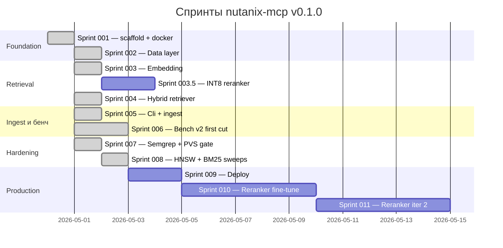

# Дорожная карта

Проект едет waterfall-спринтами. У каждого спринта явный критерий
приёмки и метка `git tag sprint-NNN-review` после прохождения. Спринты
со статусом DONE мерджнуты в `main`.

## Тайм-лайн

## Статус

| Спринт | Статус | Артефакты |
|---|---|---|
| 001 | DONE | Скелет solution, package pinning, docker stack, init.sql с `english_analyzer`. |
| 002 | DONE | EF entities, репозитории, `PgvectorFixture`, миграции `Initial` и `AddBm25Column`. 9/9 Data-тестов. |
| 003 | DONE | bge-m3 эмбеддер, bge-reranker-v2-m3 реранкер, `RerankerFamilyDetector`, скрипт скачивания моделей. 15/15 Embedding-тестов. |
| 003.5 | Queued | INT8-реранкер через Optimum O4. Merge gate — не более 1 п.п. регрессии top-1 против FP32. |
| 004 | DONE | `HybridRetriever`, 7 MCP-инструментов, stdio + HTTP хосты, CLI-глагол `serve`. 37/37 тестов плюс live HTTP smoke. |
| 005 | DONE | `CatalogReader`, `DocumentLoader` (CRLF/marker/TOC strip, MD↔JSON pair), `SectionAwareChunker`, `IngestService`, CLI-глагол `ingest`. 52/52 тестов; live ingest + MCP search верифицированы. |
| 006 | DONE | Bench v2 harness + история приземлены. Quality-стек ntx-mcp принят. Правки code-review влиты. Throughput 3 платформ (1.7/13.7/634 chunks/s). Удалённый ingest 7343 документов завершён (2026-05-01). First-cut: 38-вопросный эвристический fixture, top-10 = 81.6 %. **Extension (2026-05-02)**: arista-mcp pipeline портирован. **509-вопросный LLM-fixture (canonical baseline)**: top-1 = 79.0 %, top-5 = 99.0 %, top-10 = 100.0 %, p50 = 2.6 с, p95 = 3.7 с. |
| 007 | DONE | `scripts/pvs-studio-scan.ps1` запускается локально. `semgrep` и `pvs-studio` CI jobs в `ci.yml` (PVS гейтится через license secret). `markdownlint-cli2` job. `.githooks/pre-commit` гонит `dotnet format` на staged C# файлах. |
| 008 | DONE | One-at-a-time свип `ef_search` × `iterative_scan` × `rrf_k` × `candidate_pool_size`. 9 строк в `bench-history.jsonl`. Результат: текущие дефолты (ef=100, relaxed, rrf=60, pool=50) находятся в sweet spot quality-vs-latency на 207-q fixture. Sub-pp дельты ниже шумового floor'а n=207. См. [`sprints/sprint-008.md`](./sprints/sprint-008.md). |
| 009 | Pending | Single-file publish для Windows, Linux, macOS на amd64 и arm64. Шаблоны systemd-юнита и Windows-сервиса. |
| 010 | Pending | Cross-encoder fine-tune iter 1 на курированных triples. |
| 011 | Pending | Fine-tune iter 2 с production-log hard negatives. |

## Ключевые решения и зависимости

| Решение | Драйвер | Зафиксировано в |
|---|---|---|
| `halfvec(1024)` для `chunks.embedding` | Half precision вдвое уменьшает хранение при незначительной потере recall. | [`architecture.md`](./architecture.md) |
| Пин EF Core на 9.0.15 | `Pgvector.EntityFrameworkCore` 0.3.0 транзитивно тянет 9.0.1; нужен прямой override. | [`architecture.md`](./architecture.md) |
| Postgres на порту 5435 | Сосуществование с upstream-`arista-mcp` на 5434. | [`quickstart.md`](./quickstart.md) |
| HyDE, multi-query, listwise — вне v0.1 | Все три регрессировали на upstream-бенче. | [`training-rag.md`](./training-rag.md) |
| Bench v2 с первого дня | Bench v1 substring-scoring замаскировал три реальные регрессии на upstream. | [`training-rag.md`](./training-rag.md) |
| Подмена BM25 на `pg_textsearch` отложена | Держим v2-m3 win-рецепт константным; A/B против подмены, когда бенч-инфра готова. | [`training-rag.md`](./training-rag.md) |
