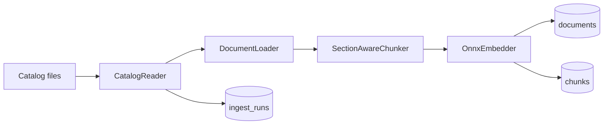

# Sprint 005 — CLI + конвейер ingest

Статус: в работе. Цель: превратить 7343 пары MD/JSON в наполненное
хранилище PostgreSQL, которое обслуживает MCP-инструмент `search_docs`.

## Аудит корпуса (2026-05-01, 7343 документа)

Локальный снимок в `C:\SHARE\nutanix-docs-mcp\data\converted\` был
прокаталогизирован до того, как компоненты `DocumentLoader` и `chunker`
застыли. Найденные паттерны определяют их дизайн.

### Распределение размеров

| Корзина | Файлов | Объём |
|---|---|---|
| < 5 KB | 4310 | 10.4 MB |
| 5–20 KB | 1500 | 13.1 MB |
| 20–100 KB | 1270 | 56.8 MB |
| 100–500 KB | 172 | 35.7 MB |
| 500 KB – 2 MB | 84 | 66.7 MB |
| > 2 MB | 7 | 20.5 MB |

KB-статьи доминируют в корзине < 5 KB. В > 2 MB — API reference и
крупнейшие admin guides.

### Здоровье заголовков и контента

| Метрика | Значение | Реакция загрузчика |
|---|---|---|
| Документы хотя бы с одним ATX-заголовком | 7343 / 7343 | OK; regex заголовков достаточно. |
| Документы короче 200 символов | 0 | OK; пропуска при ingest не нужно. |
| Документы с CRLF | 5958 / 7343 (81 %) | Loader нормализует CRLF→LF до regex (правило записано в `docs/ru/chunking.md`). |
| Документы с уцелевшими marker page-токенами (`{N}---`) | 1783 / 7343 (24 %) | Loader снимает через `\{\d+\}-+`. |
| Документы с пустыми marker image-ссылками (``) | 1782 / 7343 (24 %) | Loader снимает. |
| Документы, стартующие с `## **Contents**` | 1145 / 7343 (16 %) | Loader дропает оглавление. |
| Дубликаты stem | 0 | Каталог-ридер может использовать stem как ключ. |
| Странные / длинные заголовки | 297 | Допустимый шум — большинство легитимны (API URL, VM info panels, log-сообщения). |

### Формы JSON-обогащения

| Форма | Файлов | Что внутри `sections` | Поведение loader |
|---|---|---|---|
| `dict-list` с `{title, page}` | 5489 (75 %) | Авторитет для номеров страниц. | Парим MD↔JSON по cleaned-title. |
| `string-list` (только заголовки) | 84 (1 %) | Без страниц. | Sanity check; падаем в MD-only paging. |
| Пусто (`sections: []`, `toc: []`) | 1770 (24 %) | Без обогащения. | Чистый MD-only путь. |

`dict-list` JSON также несёт `block_stats` (счётчики каждого типа
блока, который видел конвертер) и плоский `sections` строковый список
рядом с `toc`. Loader предпочитает `toc` для маппинга страниц — там
есть `heading_level` и `page` per entry.

## Гейт приёмки Sprint 005

Спринт принят, если:

- CLI выпускает глагол `ingest`, который обходит локальный каталог,
  наполняет таблицы `documents` и `chunks`, пишет строку `ingest_runs`
  с финальными счётчиками.
- `dotnet test` зелёный по всем пяти проектам тестов.
- Полный ingest 7343-документного корпуса прошёл успешно на
  машине разработчика. Цифры записаны в этот документ.
- `get_status` через live-сервер возвращает `documents > 0` и
  `chunks > 0` против наполненной `nutanix`-БД.

## Форма конвейера

Компоненты и зоны ответственности:

| Компонент | Где живёт | За что отвечает |
|---|---|---|
| `CatalogReader` | `Core.Catalog` | Обходит `data/converted/{md,json}`, выдаёт `CatalogEntry` на stem. |
| `DocumentLoader` | `Core.Catalog` | Нормализует CRLF, снимает page-маркеры и пустые image-ссылки, дропает TOC, парсит ATX-заголовки, парит MD↔JSON секции, возвращает `LoadedDocument`. |
| `SectionAwareChunker` | `Core.Chunking` | Выпускает один parent и 1+ leaves на секцию по рецепту из `docs/ru/chunking.md`. |
| `IngestService` | `Cli.Ingest` | Оркестрирует per-document: skip по `pdf_sha256`, embed leaves, bulk-insert parents+leaves, прокручивает `ingest_runs`. |
| CLI `ingest` verb | `Cli.Commands` | Связывает `IngestService` с `CliConfiguration` и Spectre.Console-прогрессом. |

## План тестов

- `CatalogReaderTest` — находит все 7343 stem-а на локальном снимке,
  ноль дубликатов, JSON опционален.
- `DocumentLoaderTest` — фикстуры: CRLF normalise, marker-strip,
  TOC drop, MD↔JSON dict-list pair, MD↔JSON string-list pair,
  MD-only fallback, long-title канарейка.
- `SectionAwareChunkerTest` — родители per section, лист splitting на
  границе, tiny-neighbour merge ограничен секцией.
- `IngestServiceTest` — happy path, sha-skip path, partial-failure
  path (один chunk упал, остальное прошло).

## Открытые follow-ups

- Bench v2 фикстура (Sprint 006) требует курированных 100 запросов в
  JSON. Stem-ы с префиксом `kb-` помогают авторить KB-pinned запросы.
- 24 % документов без JSON-обогащения теряют номера страниц;
  рассмотреть one-off enrichment-проход через `marker` позже.
