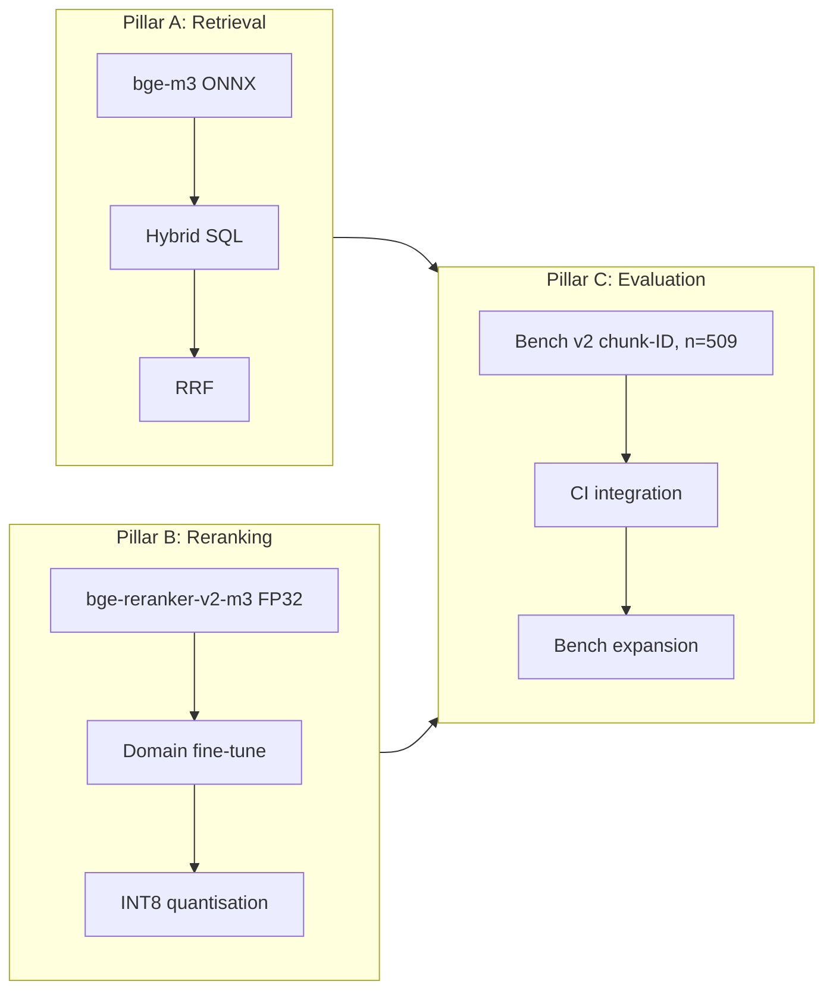

# Roadmap обучения и RAG

План качества retrieval'а делится на три pillars: dense + sparse
retrieval (pillar A), cross-encoder reranking (pillar B), evaluation
(pillar C). A и B шипят гиперпараметры; C — бенч который их гейтит.

## Pillars



## Pillar A: retrieval

Dense-путь — bge-m3 без query-prefix. Sparse-путь — vchord_bm25 с
конфигурацией `english_analyzer` (NLTK English стоп-слова + Porter2
stemmer). RRF фьюзит на `k = 60`. HNSW: `m = 16`,
`ef_construction = 200`, `ef_search = 100`,
`iterative_scan = relaxed_order`.

### Sprint 008 свип (DONE 2026-05-02)

One-at-a-time свип по 4 knob'ам подтвердил, что дефолты уже в sweet
spot quality-vs-latency на 207-q first-cut fixture. Sub-pp дельты
ниже шумового floor'а n=207:

| Свип | Результат |
|---|---|
| `ef_search` ∈ {50, 100, 200, 400} | top-1 плоско на 82.6 %, p95 ±5 % |
| `iterative_scan` strict vs relaxed | неотличимо |
| `rrf_k` 30 vs 60 | tail latency удваивается на k=30 (избегаем) |
| `rrf_k` 100 vs 60 | -0.5 п.п. top-1 (избегаем) |
| `pool=30` vs 50 | -1.9 п.п. top-1, top-10 ниже 100 % (избегаем) |
| `pool=100` vs 50 | -1.0 п.п. top-1 + 12 % p95 (избегаем) |

См. [`sprints/sprint-008.md`](./sprints/sprint-008.md).

## Pillar B: reranking

`bge-reranker-v2-m3` пришёл в Sprint 003 как Optimum-O4 ONNX.
Sprint 010 произвёл fine-tuned вариант; Sprint 003.5 квантовал
результат в INT8.

### Sprint 010 — fine-tune iter 1 (DONE 2026-05-02)

Recipe залочен на upstream arista win record:

| Компонент | Значение |
|---|---|
| Base model | `BAAI/bge-reranker-v2-m3` (XLM-R, 568M, FP32) |
| Triples | 4137 (q, passage, label), bge-m3 hard-neg майнинг |
| Mining guard | Все `expect_chunk_ids` (multi-positive) исключены из negatives |
| Loss | `BinaryCrossEntropyLoss(pos_weight=8)` |
| Optim | AdamW, lr=2e-5, warmup_ratio=0.1 |
| Batch | 16 / device, single 5090 |
| Seq | 512 |
| Epochs | 3 (669 train steps) |
| Holdout | query-hash 15 % (~64 запросов), NDCG@10 metric |

Best epoch (3) NDCG@10 = **0.9942** на holdout'е.

Дельта на продакшен bench (509-q LLM fixture):

| Метрика | v0.2.0 stock FP32 | **v0.3.0 fine-tune FP32** | Δ |
|---|---:|---:|---:|
| top-1 | 79.0 % | **80.6 %** | **+1.6 п.п.** |
| top-5 | 99.0 % | 99.4 % | +0.4 п.п. |
| top-10 | 100.0 % | 100.0 % | плоско |
| p50 (мс) | 2625 | 2737 | +4 % |
| p95 (мс) | 3675 | 3915 | +7 % |

См. [`sprints/sprint-010.md`](./sprints/sprint-010.md).

### Sprint 003.5 — INT8 квантизация (DONE 2026-05-02)

Динамическая INT8 квантизация FP32 fine-tune ONNX через
`onnxruntime.quantization.quantize_dynamic`. Изначальный блокер
(community FP16-export не квантовался — `DynamicQuantizeLinear`
отвергал FP16 входы) обойдён, потому что fine-tune производит
чистый FP32 ONNX через `optimum.exporters.onnx`.

| Метрика | FP32 fine-tune | **INT8 fine-tune** | Δ |
|---|---:|---:|---:|
| top-1 | 80.6 % | **80.2 %** | -0.4 п.п. (в пределах гейта ≤1 п.п.) |
| top-5 | 99.4 % | 99.6 % | +0.2 п.п. |
| top-10 | 100.0 % | 100.0 % | плоско |
| p50 (мс) | 2737 | **2014** | **-26 %** |
| p95 (мс) | 3915 | **2930** | **-25 %** |
| Disk | 2.17 GB | **1.30 GB** | **-40 %** |

Acceptance gate (≤1 п.п. регрессия top-1 + измеримое улучшение p95)
PASSED. INT8 — рекомендованный production deployment для CPU-only
ноутбуков (AVX-VNNI включается на session-init).

### Sprint 011 — fine-tune iter 2 (в очереди)

Курированные hard negatives из production query-логов
(анонимизированные, окно 4 недели). Merge gate: top-1 +1 п.п. без
top-10 регрессии. Заблокирован на отсутствии deployed-юзеров.

### v0.4.0 — Qwen3 swap (в очереди, scoped)

Qwen3-Embedding-0.6B и Qwen3-Reranker-0.6B (Apache-2.0, ~+5 п.п.
MTEB-multilingual / +5 п.п. BEIR-rerank vs bge-линия) — кандидаты
на v0.4.0 swap. Не drop-in: decoder-only архитектура, Qwen BPE
токенайзер (vs SentencePiece), instruct-prefix prompts, last-token
/ generative scoring. Estimate ~6-8 ч refactor + re-ingest 489K
чанков.

## Pillar C: evaluation

Bench v2 ключуется на chunk-ID gold labels с первого дня. Fixture
LLM-сгенерирован, не вручную:

```
семпл 500 чанков
  → LLM-генерация 1-2 вопросов на чанк (Qwen2.5-3B)
  → fairness filter через live retriever (top-K=20)
  → multi-positive разметка тем же LLM
  → финальный 509-q fixture
```

Live-категории в fixture: `kb`, `hardware-replacement`, `other`,
`prism-central`, `prism-element`, `ahv`, `aos`, `bible`,
`api`, `files`, `ports`. 16 категорий из изначального плана включали
6, которых в живом корпусе нет — fixture следует реальной форме
корпуса.

Каждая строка:

```json
{
  "query_id": "q-0042",
  "query": "How do I configure VLAN tagging on AHV virtual switch?",
  "expect_chunk_ids": [102, 487, 1234],
  "expect_doc": "AHV-Admin-Guide-v11_0",
  "expect_section": "...",
  "expect_product": null,
  "category": "ahv",
  "difficulty": "easy"
}
```

`expect_chunk_ids` — union допустимых хитов: source-чанк + всё что
LLM-аннотатор отметил как валидный ответ из retriever's top-10.
Top-N считает запрос hit'ом если ЛЮБОЙ из допустимых чанков в
первых N.

`expect_product` остаётся null — ingest-пайплайн не заполняет
`documents.product` для Nutanix-корпуса.

Bench-история — `tests/fixtures/bench-history.jsonl`, append-only,
одна строка на `bench`-вызов. Sprint 008 свип добавил optional поля
`ef_search`, `iterative_scan`, `reranker_dir`. Старые строки их
опускают и остаются schema-clean — `BenchRun` делает их nullable.

### Статистическая значимость

При `n = 509` 1 п.п. — это ~0.45σ (на грани детектируемости).
3 п.п. — ~1.4σ. Объявить sub-1-pp победу значимой требует
`n ≥ 1500`. **Top-10 насыщен на 100 %** на текущем распределении
fixture'а — это потолок измерения, не плато качества.

## Уроки из arista-mcp

1. **Reingest инвалидирует бенч.** Каждый full reingest переназначает
   `chunks.id`, поэтому любой chunk-pinned fixture дрейфует. Делайте
   bench против стабильного снапшота, re-pin'те через
   `validate-bench-queries` после каждого reingest'а.
2. **Top-1 плато раньше чем top-10.** Пять levers upstream-линии
   сошлись на 72-74 % top-1 и 99.10 % top-10 на 588-q бенче. Наш
   fixture повторяет паттерн — top-10 потолок 100 % на n=509.
3. **CPU-only ingest дорогой на масштабе.** Full-corpus прогон
   arista — ~25 минут CPU на 159 документах. Nutanix 7343 doc'а
   занимают ~2 часа на ноутбучном CPU vs ~13 мин на одной 5090.

## CI-гейтинг

| Job | Триггер | Поведение |
|---|---|---|
| `build-and-unit-test` | Каждый push в main + PR | `dotnet test` исключая Pgvector collection. |
| `integration-test` | Каждый push в main + PR | `dotnet test` против Postgres service-контейнера. |
| `docs-lint` | Каждый push в main + PR | `markdownlint-cli2` на всех `*.md`. |
| `semgrep` | Каждый push в main + PR | `semgrep scan --config=auto --error` на `src/`. |
| `pvs-studio` | Push в main (гейтится license secret) | PVS-Studio C# скан; пропускается без `${{ secrets.PVS_USER }}`. |

Bench-as-CI в очереди но не активен — full bench нужен наполненный
PG. Bench — manual acceptance step, гонится на наполненной dev/staging PG.

## Levers исключённые из v0.3.0

- **Embedder fine-tune.** Multilingual prior bge-m3 — user-stated
  требование (Russian запросы против английского корпуса).
- **HyDE rewriting и listwise re-rank.** Оба регрессировали на
  upstream бенче.
- **Multi-query expansion.** Регрессировал на upstream бенче.
- **`pg_textsearch` (Tapir) BM25 swap.** Tracked как v0.4.x
  кандидат-эксперимент.
