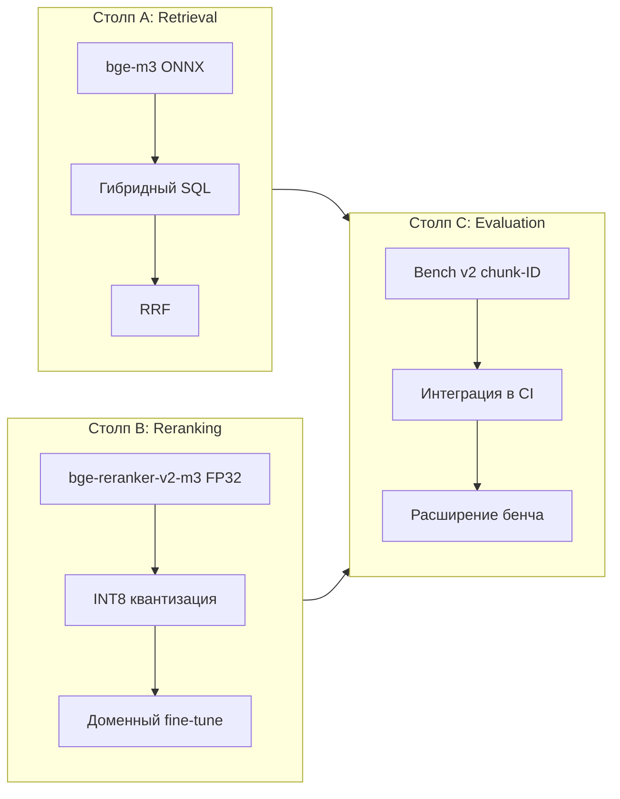

# Обучение и RAG

План качества поиска делится на три столпа: dense + sparse retrieval
(столп A), cross-encoder reranking (столп B), evaluation (столп C).
Столпы A и B выпускают гиперпараметры; столп C выпускает бенчмарк,
который их гейтит.

## Столпы коротко



## Столп A: retrieval

Плотный путь — bge-m3 без префикса запроса. Sparse — vchord_bm25 с
конфигом `english_analyzer` (стопслова NLTK English, стеммер Porter2).
RRF сливает стороны при `k = 60`. HNSW сконфигурен с `m = 16`,
`ef_construction = 200`, `ef_search = 100`,
`iterative_scan = relaxed_order`.

Свипы под Sprint 008:

| Свип | Сетка | Гипотеза |
|---|---|---|
| `ef_search` | 50, 100, 200, 400 | Top-10 растёт ценой p95-латентности. |
| `m` (требует пересборки) | 16, 32, 48 | Recall растёт на rare-token-запросах. |
| `RrfK` | 30, 60, 100 | Trade-off веса sparse-only-hit. |
| `iterative_scan` | `strict_order` vs `relaxed_order` | Латентный пол. |

## Столп B: reranking

`bge-reranker-v2-m3` в Sprint 003 поставляется как Optimum-O4 ONNX
экспорт в FP32. INT8-квантизация через
`optimum-cli onnxruntime quantize --avx512_vnni` стоит в очереди на
Sprint 003.5; merge-гейт — не более 1 п.п. регрессии top-1 против FP32
при измеримом p95-улучшении.

Доменный fine-tune (Sprint 010) повторяет upstream-рецепт v2-m3 с
nutanix-специфичными triples:

1. Курировать triples через `nutanix-mcp curate-triples`. Фильтр
   hard-negative: positive и negative различаются и по документу, и по
   product.
2. Цель — 4000–6000 (q, pos, neg) triples.
3. Гиперпараметры залочены под upstream-рецепт: backbone XLM-R 568M,
   loss BCE с `pos_weight = 8`, multi-positive mining, lr 2e-5, batch
   32, 3 epochs, warmup 0.06, mixed precision.
4. Экспорт в ONNX, квантизация в INT8 с avx512_vnni.
5. Acceptance gate: top-1 +3 п.п. над FP32 off-the-shelf реранкером.

Вторая итерация (Sprint 011) добавляет курированные hard negatives из
production query logs (анонимизированные, окно 4 недели). Merge gate:
top-1 +1 п.п. без регрессии top-10.

## Столп C: evaluation

Bench v2 стартует с chunk-ID gold labels с первого дня. Бюджет
запросов на первом срезе — 100 hand-curated, по всем 16 категориям:
`ahv`, `aos`, `kb`, `files`, `ndb`, `kubernetes`, `flow`,
`prism-central`, `prism-element`, `move`, `disaster-recovery`,
`cloud-clusters`, `nki`, `pulse`, `lcm`, `hardware-replacement`. Состав:
50% easy (verbatim term match), 30% medium (paraphrased), 20% hard
(cross-doc или terminology drift).

Схема:

```json
{
  "query_id": "ahv-vlan-001",
  "query": "How do I configure a VLAN on AHV virtual switch?",
  "expect_chunk_ids": [102, 487, 1234],
  "expect_doc": "AHV-Admin-Guide-v11_0",
  "expect_section": "AHV Virtual Switch VLAN Configuration",
  "expect_product": "ahv",
  "category": "ahv",
  "difficulty": "easy"
}
```

`expect_chunk_ids` — объединение допустимых попаданий. Top-N считается
hit, если любой допустимый chunk попал в первые N результатов.

История бенча копится в `tests/fixtures/bench-history.jsonl`,
append-only, одна строка на запуск `bench`:

```json
{
  "timestamp": "2026-05-12T10:00:00Z",
  "label": "v0.2.0",
  "queries": 100,
  "top_1": 0.82,
  "top_5": 0.94,
  "top_10": 0.97,
  "p50_ms": 1450,
  "p95_ms": 2300,
  "embedder": "bge-m3",
  "reranker": "bge-reranker-v2-m3-fp32",
  "rrf_k": 60,
  "ef_search": 100,
  "rerank_top_n": 30,
  "git_sha": "abc123"
}
```

Порог значимости: при `n = 100` дельта в 5 п.п. — это около 1σ. Чтобы
объявить sub-3 п.п. победу значимой, нужно `n ≥ 300`. Расширение бенча
до этого размера зависит от насыщения top-10; upstream-бенч дошёл до
стенки на 99.10% при 588 запросах.

## Гейтинг в CI

| Job | Триггер | Поведение |
|---|---|---|
| `unit` | Каждый PR | `dotnet test` без коллекции Pgvector. |
| `integration` | Каждый PR | `dotnet test` против `nutanix_test`. |
| `bench-smoke` | PR с лейблом `bench` | 30-q smoke-набор; build падает, если top-10 опустился ниже 80%. |
| `bench-full` | Еженедельный cron | 100+ запросов, append в `bench-history.jsonl`, дифф постится в issue. |

## Что вне v0.1

- Fine-tune эмбеддера. Upstream не пробовал; multilingual-prior bge-m3 —
  явно поставленное требование (RU-запросы по EN-корпусу). Осмысленный
  тренировочный набор под Nutanix-специфику требует ингеста customer
  logs, которых у проекта нет.
- HyDE и listwise-рерэнк. Оба регрессировали на upstream-бенче.
  Возвращаемся при наличии локально доступной frontier-class LLM.
- Подмена BM25 на `pg_textsearch` (Tapir). Кандидат-эксперимент v0.2 или
  v0.3 в [`roadmap.md`](./roadmap.md). Merge gate — снижение p95 при
  не падающем top-1 recall на bench v2.
